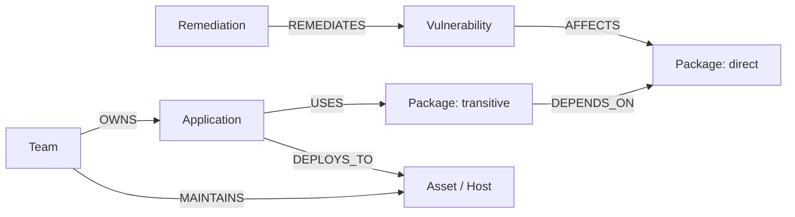

# PatchPilot Architecture & Design Specification

**PatchPilot** is a graph-native vulnerability triage, blast-radius analysis, and autonomous remediation agent built on **FalkorDB** for WeMakeDevs Graph Hacks (Track 01: Agents That Act on Connected Data).

---

## 1. System Overview

Traditional Vulnerability Management (VM) tools treat CVEs in isolation using static CVSS scores. This results in alert fatigue: a CVSS 9.8 flaw in an isolated test environment often gets flagged with the same urgency as a CVSS 7.5 flaw directly reachable from the internet on a core payment gateway.

**PatchPilot solves this using Connected Data in FalkorDB**:
1. Connects CVEs to software packages (direct & transitive dependencies).
2. Connects packages to running application services.
3. Connects applications to physical/cloud infrastructure assets (with exposure level & business criticality).
4. Connects assets to engineering teams and code owners.
5. Employs an AI Investigation Agent that queries the graph in real-time, computes contextual priority scores, generates step-by-step reasoning, and creates actionable remediation proposals.

```
+-----------------------------------------------------------------------------------+
|                                 PatchPilot Web UI                                 |
|  - Threat Overview Dashboard    - Graph Visualization (React Flow / Dagre)       |
|  - Autonomous Triage Drawer     - Step-by-Step Reasoning Timeline                |
|  - Remediation Action Modal     - FalkorDB Health & Benchmark Diagnostics         |
+-----------------------------------------------------------------------------------+
                                        |  REST API & SSE
                                        v
+-----------------------------------------------------------------------------------+
|                             FastAPI Backend Service                               |
|  - /api/vulnerabilities         - /api/investigate (Triage Agent Engine)          |
|  - /api/graph/path              - /api/remediations (Action Lifecycle)            |
|  - /api/overview/stats          - /api/status (Health / Benchmark / Seeder)       |
+-----------------------------------------------------------------------------------+
                   |                                           |
                   v                                           v
+------------------------------------+       +------------------------------------+
|        AI Reasoning Engine         |       |         FalkorDB Cypher Engine     |
| - Deterministic Graph Reasoner     |       | - Low-latency Cypher Graph Queries |
| - OpenAI / Anthropic Integration   |       | - Multi-hop blast radius paths     |
| - Evidence-backed prioritization   |       | - Transitive dependency reach      |
+------------------------------------+       +------------------------------------+
```

---

## 2. Graph Schema & Node Typology

PatchPilot models enterprise software security as a directed property graph in FalkorDB:

### Node Types
- `(:Vulnerability)`: Identifies a CVE (e.g., `CVE-2021-44228`). Properties: `id`, `cve_id`, `title`, `severity` (CRITICAL, HIGH, MEDIUM, LOW), `cvss_score`, `epss_score`, `has_exploit`, `description`, `patch_version`.
- `(:Package)`: Open-source or vendor software library. Properties: `id`, `name`, `version`, `ecosystem` (maven, npm, pypi, go).
- `(:Application)`: Microservice or monolith running inside the organization. Properties: `id`, `name`, `repo_url`, `language`, `tier`.
- `(:Asset)`: Deployment target (Kubernetes cluster, EC2 instance, database). Properties: `id`, `name`, `type` (k8s-pod, ec2-instance, rds-database, cloud-function), `environment` (production, staging, internal), `exposure` (public, internal, isolated), `criticality` (tier_1, tier_2, tier_3).
- `(:Team)`: Engineering or SecOps team responsible for remediation. Properties: `id`, `name`, `email`, `slack_channel`, `on_call`.
- `(:Investigation)`: Triage run record persisted directly into the graph.
- `(:Remediation)`: Action item tracked through resolution.

### Relationship Types
- `(:Vulnerability)-[:AFFECTS]->(:Package)`: Links a vulnerability to its affected package versions.
- `(:Package)-[:DEPENDS_ON]->(:Package)`: Direct or transitive library dependency relationship.
- `(:Application)-[:USES]->(:Package)`: Identifies application manifests consuming packages.
- `(:Application)-[:DEPLOYS_TO]->(:Asset)`: Maps applications to active runtime infrastructure.
- `(:Team)-[:OWNS]->(:Application)` and `(:Team)-[:MAINTAINS]->(:Asset)`: Operational ownership.
- `(:Investigation)-[:EVALUATED]->(:Vulnerability)`: Agent audit trail.
- `(:Remediation)-[:REMEDIATES]->(:Vulnerability)`: Corrective actions.



---

## 3. Prioritization Scoring Formula

Unlike static CVSS, PatchPilot calculates an **Evidence-Backed Priority Score (0-100)**:

$$\text{Priority Score} = w_1 S_{\text{reach}} + w_2 S_{\text{asset}} + w_3 S_{\text{cvss}} + w_4 S_{\text{exploit}}$$

1. **Reachability Score ($S_{\text{reach}}$, weight: 0.35)**:
   - Direct production dependency: 100
   - 1 hop transitive in production: 80
   - $\ge 2$ hops transitive in production: 60
   - Staging/dev reachability: 30
   - Completely unreferenced in running apps: 10
2. **Asset Criticality Score ($S_{\text{asset}}$, weight: 0.30)**:
   - Tier 1 + Internet-Facing (`exposure: public`): 100
   - Tier 1 + Internal network: 70
   - Tier 2 public: 60
   - Tier 2 internal: 40
   - Tier 3 / Isolated sandbox: 15
3. **Vulnerability Severity Score ($S_{\text{cvss}}$, weight: 0.20)**:
   - Normalized CVSS $10 \times \text{CVSS}$
4. **Exploitability Score ($S_{\text{exploit}}$, weight: 0.15)**:
   - Known exploit in the wild (`has_exploit: true`) or high EPSS (> 0.5): 100
   - Public PoC available: 60
   - Theoretical / no known exploit: 20

### Priority Bands
- **CRITICAL**: Score $\ge 80$ (Immediate page to team on-call)
- **HIGH**: $60 \le \text{Score} < 80$ (Patch within 7-day SLA)
- **MEDIUM**: $40 \le \text{Score} < 60$ (Next planned sprint)
- **LOW**: $\text{Score} < 40$ (Routine dependency maintenance)

---

## 4. Triage & Remediation Agent Workflow

1. **Trigger**: New vulnerability webhook or analyst selection in PatchPilot UI.
2. **Step 1 - Vulnerability Detail Extraction**: Reads CVE metadata, CVSS base score, exploit availability.
3. **Step 2 - Graph Dependency Traversal**: Cypher query traverses `[:AFFECTS]` and inverse `[:DEPENDS_ON*]` paths to locate every dependent package and application.
4. **Step 3 - Infrastructure Blast Radius**: Traverses `[:DEPLOYS_TO]` to enumerate impacted assets, filtering for public-facing and Tier 1 production hosts.
5. **Step 4 - Ownership Resolution**: Traverses `[:OWNS]` and `[:MAINTAINS]` to identify exact engineering leads, emails, and Slack channels.
6. **Step 5 - Multi-factor Scoring**: Calculates composite risk score and compares it against CVSS.
7. **Step 6 - Action Proposal Formulation**: Proposes safe package upgrades, WAF mitigation rules, or network isolation based on whether breaking changes are expected.
8. **Step 7 - Graph Persistence**: Stores the investigation result and remediation state back into FalkorDB.
